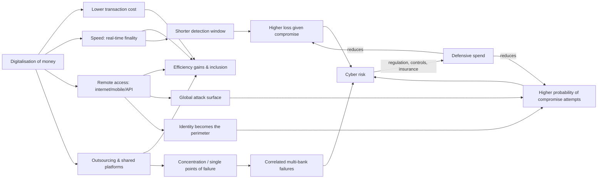

# Part 1 — First Principles: Why Banks Attract Cyberattacks

## 1.1 Money used to be guarded by walls, signatures and ledgers

For most of banking history, a bank's security rested on three things:

1. **Physical custody.** Coin, bullion and notes sat in vaults, and stealing them meant physical presence, force and getting away.
2. **Human verification.** A teller compared a signature, a clerk recognised a merchant, a manager approved a large withdrawal. Each step relied on a person who could notice something odd.
3. **Recordkeeping.** Double-entry ledgers, which spread from Renaissance Italy, made the bank's books self-checking. Every debit had a matching credit, and a theft left a hole that reconciliation could find.

Fraud existed (forged bills of exchange, embezzling clerks), but it was **bounded by human throughput**. One forger could pass a limited number of forged instruments, one at a time, and each was a chance to get caught.

## 1.2 From ledgers to databases to networks

| Era | Technology | What changed about risk |
|---|---|---|
| 1950s–60s | Mainframes (e.g., Bank of America ERMA, 1959); MICR cheque encoding | The ledger moved into a machine, and a few operators could change many records |
| 1960s–70s | ATMs (UK 1967); card networks (BankAmericard 1958 → Visa 1976; Interbank → Mastercard) | Customers authenticate to a **machine** with a card and PIN. Authorization becomes a computed decision |
| 1970s | SWIFT (founded 1973, live 1977); CHIPS (1970); Fedwire computerised | Interbank instructions become **authenticated messages**. A message *is* the money movement |
| 1980s–90s | Dial-up corporate cash management; ACH; RTGS systems | Customers initiate high-value payments remotely (the setting of the 1994 Citibank case) |
| late 1990s–2000s | Internet banking; e-commerce card-not-present | The attack surface becomes global, and anyone online can reach the login page |
| 2010s | Mobile banking; cloud; APIs; outsourcing | The bank's perimeter dissolves into vendors, clouds and partner apps |
| late 2010s–2020s | Real-time payments (UK FPS 2008, India UPI 2016, SEPA Inst 2017, US FedNow 2023, Brazil Pix 2020); open banking | Settlement is final in seconds, so the detection window shrinks toward zero |
| 2020s | Embedded finance, Banking-as-a-Service, AI | Authorization logic is spread across partners, and attackers automate |

## 1.3 What happens to trust when money becomes ledger entries

Today almost all money is a **liability recorded in a database**. Your deposit is a row stating that the bank owes you X. Central-bank reserves are rows at the central bank. Payments are messages that tell two databases to change in step.

So "security" now means something different:

- **Confidentiality.** Is customer and transaction data kept secret?
- **Integrity.** Is the record of who owns what correct? This is the deepest property. A bank whose ledger can't be trusted has no product.
- **Availability.** Can customers and counterparties transact when they need to?
- **Authenticity of instructions.** Did the legitimate owner actually order this payment?

The physical vault defended mainly against theft of the asset. A digital bank must defend the *process that decides who owns the asset*.

## 1.4 Why compromising authorization beats stealing data

A stolen card database has to be *monetised*. Someone has to sell it, cards have to be cloned, mules have to cash out, and issuers detect and block along the way. Each step leaks value and adds detection risk. In large US card breaches, the price per stolen record on criminal markets fell to a few dollars or less (REPORTED, from law-enforcement and vendor research).

Compromising **authorization** (the approve/decline decision, or the payment-instruction channel) skips most of that chain:

- **Bangladesh Bank (2016):** attackers with control of the bank's SWIFT endpoint could *instruct the Federal Reserve Bank of New York in Bangladesh Bank's name*, and USD 101m moved.
- **Cosmos Bank (2018):** a rogue switch answered "approved" to cloned-card withdrawals, and about INR 94 crore (≈USD 13.5m) left in roughly two days.
- **RBS WorldPay (2008):** raising limits on 44 cards produced about USD 9.4m in 12 hours.

**Principle:** data theft is like stealing the key-cutting templates. Authorization compromise is like *becoming the lock*.

## 1.5 Solvent but unable to pay: operational illiquidity

A bank can have plenty of capital and good loans and still **fail to pay** if:

- its payment systems are down, so it can't send or receive;
- it can't tell how much it owes (ledger integrity is in doubt);
- it can't access its central-bank account or collateral;
- its settlement agent or clearing broker is down.

ICBC Financial Services (Nov 2023) is the clearest public example. The broker-dealer had the economic resources, with parent backing, but for days **could not operationally settle US Treasury trades** (see `global_case_studies.md`). This is a *third* failure mode alongside solvency and funding-liquidity failure. Call it **operational liquidity failure**.

## 1.6 Interconnection and single points of failure

Banks have rationally outsourced and shared infrastructure: card processors, ATM switches, core-banking service bureaus, cloud providers, security software, SWIFT service bureaus, national payment switches. Each shared node:

- lowers cost and raises standardisation, **and**
- concentrates risk, because one failure hits many banks at once.

Examples in the database:

- **C-Edge (2024):** about 300 Indian co-operative banks went down via a single vendor.
- **Shinkin Kyodo Center (6 Nov 2026):** an equipment fault (not an attack) stopped ATMs and counters at 128 shinkin banks.
- **CrowdStrike (2024):** a faulty update took down banks worldwide.
- **ISC (Iran, 2026):** attacks on a shared card switch hit three state banks.

## 1.7 Why criminals pick banks, and why they often don't

| Factor | Banks as target | Comparison |
|---|---|---|
| Payoff | Very high per success, since money is directly transferable | Retail and healthcare pay via ransom only |
| Defences | Among the strongest of any sector (large budgets, regulators) | Weaker in SMEs and vendors |
| Monetisation | Hard, because traceable transfers can be recalled and frozen | Crypto is easier |
| Law-enforcement attention | Very high | Lower |

The economics push attackers toward:

1. **The weakest node connected to bank money flows** (small banks, NBFCs, vendors, customers).
2. **Monetisation paths with fast finality** (ATM cash-outs, real-time payments, crypto off-ramps).
3. **Jurisdictions with no extradition** (North Korea, parts of the former Soviet space).

This explains a lot of the history. Attackers moved from big-bank cores toward *the edges of the bank's trust network*.

## 1.8 The criminal's expected-value equation (conceptual)

```
E[payoff] = P(access) × P(execute before detection) × Amount × (1 − haircut on laundering) × P(not recalled)
            − cost of tooling/services − P(caught) × penalty
```

Each era of defence attacked one term:

- MFA lowered P(access).
- SWIFT CSP and NY Fed screening lowered P(execute).
- Recall and freezing raised the recall probability, lowering P(not recalled).

Each era of offence pushed back:

- RaaS and initial-access brokers lowered the cost.
- Real-time rails and crypto lowered the laundering haircut and the chance of recall.
- A safe haven lowers P(caught) to near zero. For state actors like DPRK, the "penalty" term barely exists, which is why the *amount* term dominates their targeting.

**Cost of defence:** large banks report multi-billion-dollar annual technology budgets. For example, JPMorgan has publicly cited roughly USD 15–18bn total technology spend in recent years, and Bank of America and Citi report similar orders of magnitude (REPORTED, from investor-day and annual-report statements; cyber is a subset). Small banks can't match this, so they rely on vendors, and the vendors become the concentration point.

## 1.9 Causal diagram: digitalisation raises efficiency *and* exposure



## 1.10 Taxonomy: what is (and isn't) an institutional cyber compromise

| Category | Definition | Example | In this database? |
|---|---|---|---|
| **Institutional cyber compromise** | An adversary gains unauthorised access to the institution's (or its agent's) systems | Bangladesh Bank, Capital One, ICBC FS | Yes |
| **Third-party compromise** | Adversary compromises a vendor or processor that serves the bank | C-Edge, MOVEit, Arkéa (reported) | Yes, flagged |
| **Customer fraud (account takeover, scams)** | Customer credentials or devices compromised, or customer manipulated (APP fraud) | Zeus, Japan securities ATO | Only where systemic or campaign-level |
| **Technology failure / outage** | Non-malicious failure | CrowdStrike 2024; Shinkin 6 Nov 2026 | Yes, as **comparators** (`is_cyberattack=False`) |
| **Insider theft** | Employee or contractor abuses legitimate access | Coinbase support-agent bribery | Yes when IT-enabled |
| **Traditional fraud** | Forgery, loan fraud, rogue trading | Not included | No |

**Why the distinction matters:** regulators, insurers and accountants treat these differently. A *technology failure* and a *cyberattack* can have identical customer impact, but different legal reporting duties, insurance coverage, Basel event-type mapping, and implications for future probability.
