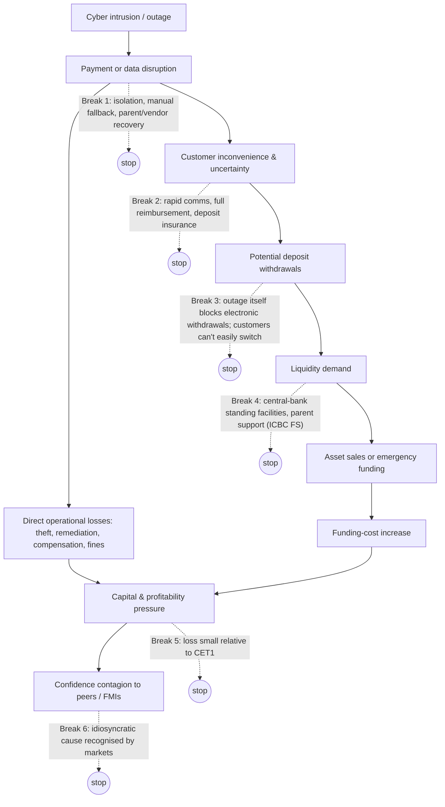

# Part 6 — How Cyberattacks Can Destabilise Banks

## 6.1 The transmission chain, and where it breaks

**A paradox at Break 3.** During a total outage, customers *can't* withdraw electronically, so a run is mechanically blocked *during* the event. The run risk sits **after restoration**, if confidence has been damaged, and at **peer banks** that customers fear share the weakness. Digital runs can be very fast: Silicon Valley Bank lost about USD 42bn of deposits in a day in March 2023, a **non-cyber** credit and interest-rate event. So if confidence breaks once services return, it can break quickly.

## 6.2 Risk types distinguished

| Risk | Definition | Cyber example |
|---|---|---|
| Operational risk (Basel) | Loss from failed processes, people, systems or external events | All incidents; Basel event types: *external fraud*, *business disruption and system failures*, *clients, products and business practices* (fines) |
| Fraud risk | Loss from deception or unauthorised transactions | Bangladesh, Cosmos, API abuse |
| Liquidity risk | Inability to meet obligations as they fall due | ICBC FS (operational liquidity) |
| Settlement risk | A transfer doesn't complete as expected | ICBC FS Treasury trades |
| Counterparty risk | A counterparty fails to perform | BNY's exposure to ICBC FS (REPORTED ~USD 9bn intraday/overnight) |
| Solvency risk | Losses exceed capital | **No confirmed cyber case found for a regulated bank** |
| Reputation risk | Loss of confidence affecting franchise | Lotte Card (rating-agency concerns; issuance ban) |
| Systemic risk | Impairment of the financial system's functioning | Concentration (C-Edge, CrowdStrike); FMI attacks |

## 6.3 Has a cyberattack ever directly caused a bank failure?

**Finding: we found no empirically confirmed case of a cyberattack directly causing the failure of a regulated deposit-taking bank** (INFERRED from the absence of evidence in sources reviewed. This is not proof that none exists, particularly for very small institutions in jurisdictions with limited disclosure.)

Related cases that *come close* or are often mis-cited:

- **Non-bank failures from theft:** crypto exchanges collapsed or wound down after hacks (Mt. Gox 2014; **DMM Bitcoin wound down after the 2024 theft**, although customers were made whole by its parent). These are not banks.
- **Processor failure:** CardSystems Solutions (2005) lost its card-network acceptance and was sold.
- **Business-model failures with a cyber component:** we found no reliable case where cyber was decisive for a bank.
- **Regulatory franchise damage:** Lotte Card's 1.5-month ban on new-card issuance (2026). Serious, but not failure.

**Why the chain usually breaks:**
1. Direct losses are small relative to capital. The largest bank theft on record, Bangladesh at ~USD 81m, hit a *central bank*.
2. Customers are made whole, which separates customer loss from bank loss.
3. Parents, central banks and deposit insurance backstop liquidity.
4. Outages are usually idiosyncratic, and markets tell the difference.

**Conditions under which a cyber-induced failure becomes plausible (INFERRED):**
- a **data-integrity** attack that destroys confidence in balances (customers don't know what they own) and lasts long enough that restoration from trustworthy backups fails;
- a **prolonged outage** (weeks) at a bank with flighty, uninsured, digitally mobile deposits and weak profitability;
- a **large theft** at a thinly capitalised institution (small banks, co-operatives, NBFCs);
- a **common-mode failure** at a shared vendor or FMI hitting many banks, making confidence effects correlated;
- **coincidence** with a pre-existing credit or rate shock (cyber as the trigger, not the root cause).

## 6.4 Cyber stress versus traditional runs and credit failures

| Dimension | Credit-loss failure (e.g., 2008) | Rate/deposit run (SVB 2023) | Cyber-induced stress |
|---|---|---|---|
| Root | Asset quality | Duration mismatch + uninsured deposits | Operational |
| Speed | Months to years | Hours to days | Minutes (theft) to weeks (outage) |
| Observability | Accounting lag | Social media, fast | Often *opaque*: the firm may not know its own state |
| Capital hit | Large | Large (unrealised losses crystallised) | Usually small, unless integrity is lost |
| Policy tool | Capital, resolution | Liquidity, deposit guarantees | Recovery capability, substitutability, FMI backups, liquidity |
| Contagion channel | Common exposures | Common business model | **Common technology** |

## 6.5 Scenario analysis (hypothetical, transparent)

**All numbers below are ASSUMPTIONS for a stylised mid-size bank. They are not forecasts.**
- Stylised bank: total assets USD 200bn; deposits USD 150bn (30% uninsured); CET1 USD 16bn (12% of RWA USD 133bn); HQLA USD 30bn; annual pre-tax earnings USD 3bn.

| Scenario | Assumption set | Direct loss | Liquidity | Capital | Main mitigant | Historical analogue |
|---|---|---|---|---|---|---|
| **Mild: 24-hour payment outage** | Channels down 24h; backlog cleared in 48h | USD 20–50m (overtime, fee waivers, compensation) | Intraday liquidity needs met from HQLA; possible central-bank intraday credit | <0.3% of CET1 | Manual fallback; central bank | Shinkin 6 Nov 2026 (non-malicious, ~5h); CrowdStrike |
| **Adverse: 7-day operational disruption (ransomware)** | Core channels down 7 days; data exfiltrated | USD 150–400m (recovery, legal, compensation, lost revenue) | 2–5% deposit outflow *after* restoration (assumed) = USD 3–7.5bn → within HQLA | ~1–2.5% of CET1 | Immutable backups; customer comms | Patelco (2 weeks), ICBC FS (days) |
| **Third-party failure, multiple banks** | Shared core vendor down 3–5 days for 20 small banks | Per bank small; system-wide moderate | Correlated small-bank outflows to large banks; payment operator isolates vendor | Small banks: 2–10% CET1 if extended | Network isolation (NPCI), vendor exit plan | C-Edge 2024 |
| **Major payment-fraud loss** | USD 500m unrecovered fraudulent transfers | USD 500m | Limited | ~3% CET1; one quarter's earnings at risk | Velocity caps; recall | Bangladesh scaled; Arkéa (reported EUR 100–118m) |
| **Deposit withdrawals after prolonged outage** | 14-day outage + data-integrity doubt; 15% uninsured and 5% insured outflow in 2 weeks post-restoration | USD 0.5–1bn | Outflow ≈ USD 6.75bn + 5.25bn = USD 12bn → 40% of HQLA; needs asset sales or discount window | Funding cost +50–150bp on wholesale (assumed); earnings hit | Central-bank facilities; deposit insurance | No full real analogue |
| **Contagion to a critical settlement institution** | Clearing/settlement agent unable to settle for 2 days in a core market | Hard to quantify | Gridlock: participants can't receive expected funds; demand for central-bank liquidity | Counterparty exposures | Central-bank backup; FMI recovery; manual settlement | ICBC FS (small node); ION (derivatives middle office); hypothetical at scale |

**Reading the scenarios.** Capital is rarely the binding constraint. **Operational recovery time and post-event confidence are.** The IMF (GFSR, April 2024) similarly concluded that extreme cyber losses could cause funding strains and that the main risk channel is loss of confidence and disruption of critical services (REPORTED from training knowledge; also echoed in the May 2026 IMF blog via secondary sources).

## 6.6 Quantitative anchors (with caveats)

| Metric | Value | Source and status |
|---|---|---|
| Financial-sector share of cyber events (162 countries, ~10 years) | ~10% | IMF WP/26/62 abstract (REPORTED via RePEc/IMF listing) |
| Cyber-enabled fraud | "nearly tripled", underestimated | IMF WP/26/62 abstract (REPORTED) |
| EU banks: agreement that cyber is the top operational-risk driver | 74% (spring 2026) vs 82% a year earlier | EBA RAR June 2026 (CONFIRMED) |
| EU: "cyberattacks have not materially increased" | qualitative | EBA RAR June 2026 (CONFIRMED) |
| Largest single theft (any financial firm) | ~USD 1.46–1.5bn (Bybit 2025) | FBI PSA (CONFIRMED) |
| Largest bank SWIFT theft | ~USD 81m net of reversal (Bangladesh 2016) | DOJ/press (CONFIRMED) |
